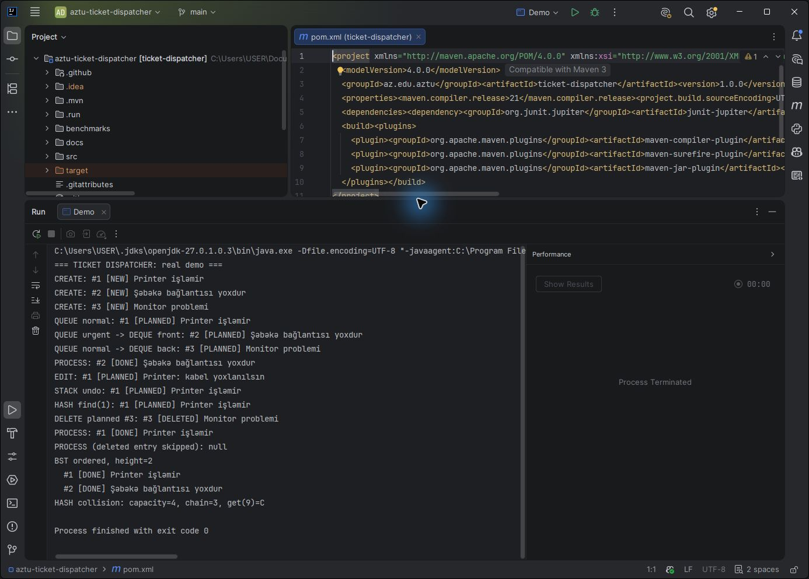
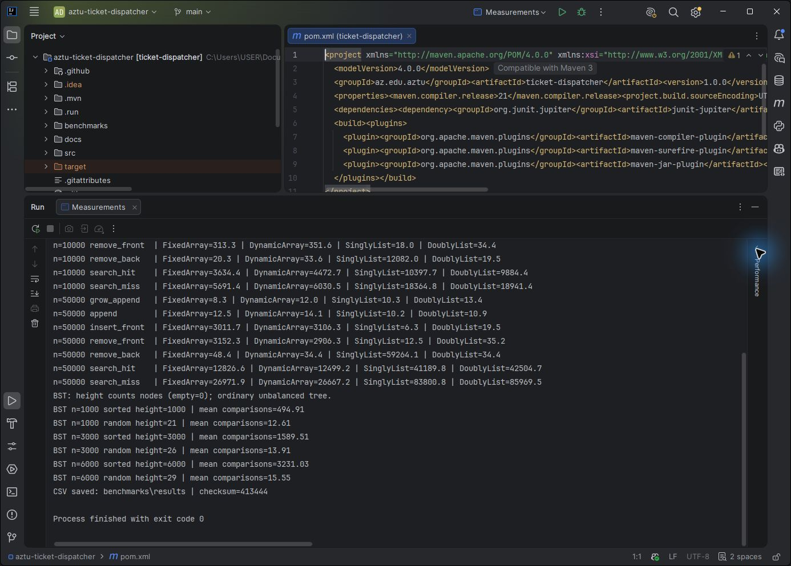
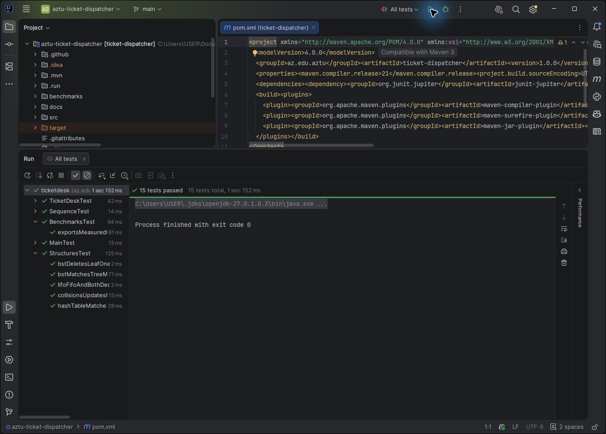

# Ticket Dispatcher — sorğu dispetçeri

AzTU, M656aS · Müasir data strukturları və alqoritmləri · Sərbəst iş №1

Komanda: **Vaqif Paşayev, Riad Qurbanov, Baloğlan Əhmədov, Ayxan Əliyev**.

Texniki dəstəyə gələn sorğuları qəbul edən kiçik Java konsol proqramıdır. Sorğu əvvəl növbəyə düşür, sonra adi və ya təcili kimi iş planına keçir. Təcili sorğu birinci icra olunur. Başlıq dəyişikliyini geri qaytarmaq, ID ilə axtarmaq və sorğunu silmək mümkündür.

## İşə salmaq

JDK **21** lazımdır. Maven Wrapper layihəyə daxildir; ilk build üçün internet lazımdır.

Windows PowerShell:

```powershell
.\mvnw.cmd -B clean verify
java -jar target/ticket-dispatcher-1.0.0.jar --demo
java -jar target/ticket-dispatcher-1.0.0.jar
```

Linux/macOS: `./mvnw -B clean verify`, sonra eyni `java -jar ...` əmrləri.

IntelliJ IDEA-da layihə qovluğunu Maven layihəsi kimi açın, Project SDK-ni JDK 21 seçin və importun bitməsini gözləyin. `.run` qovluğundakı **Demo**, **Console** və **Measurements** konfiqurasiyaları hazırdır. Testlər `src/test/java` qovluğundadır.

## Kiçik sınaq

```text
new Printer işləmir
new Şəbəkə bağlantısı yoxdur
triage normal
triage urgent
process
edit 1 Printer kabelini yoxla
undo
find 1
ordered
stats
quit
```

Burada `process` əvvəl ikinci sorğunu tamamlayır: o, təcili kimi deque-nin əvvəlinə əlavə olunub. `undo` yalnız son başlıq dəyişikliyini geri qaytarır. `help` bütün əmrləri göstərir.

## Tapşırığın hissələri

| Hissə | Reallaşdırma və istifadə |
|---|---|
| Array / Dynamic Array | `FixedArray`, `DynamicArray`; müxtəlif ölçülərdə əlavə, silmə və axtarış ölçülür. Dinamik massiv bütün sorğuların kataloqudur. |
| Singly / Doubly Linked List | Hər ikisi öz node-ları ilə yazılıb; eyni əməliyyatlar müqayisə olunur. |
| Stack / Queue / Deque | Başlığı geri qaytarmaq / yeni sorğuların FIFO növbəsi / təcili və adi iş planı. Hər biri yuxarıdakı öz strukturlarımız üzərindədir. |
| Hash Table | Ayrı zəncirləmə (chaining), yük əmsalına görə böyümə; ID ilə axtarış. Demo-da 1, 5, 9 açarları eyni bucket-ə düşür. |
| Binary Search Tree | Əlavə, axtarış, silmə, in-order; sorğuları ID sırası ilə göstərir. Sıralanmış girişdə balanssız ağacın zəifləməsi ayrıca ölçülür. |

Strukturlar `src/main/java/az/edu/aztu/ticketdesk/structures` qovluğundadır. Onların daxilində hazır `ArrayList`, `LinkedList`, `HashMap` və `TreeMap` istifadə olunmur. Testlərdə JDK kolleksiyaları nəticəni müstəqil yoxlamaq üçün işlədilir.

## IntelliJ IDEA-da icra

### Sorğunun işlənməsi

Demo-da ikinci sorğu təcili seçildiyinə görə birinci tamamlanır. Sonra başlıq dəyişikliyi geri alınır, üçüncü sorğu silinir və indekslərdən qalan sorğular göstərilir. Sonda 1, 5 və 9 açarlarının eyni bucket-də yaratdığı üç elementli zəncir görünür.



### Ölçmələrin konsol çıxışı

Bu ekran görüntüsü aşağıdakı cədvəllərin mənbəyi olan Measurements icrasının yekununu göstərir.



### Test nəticəsi

JUnit-də 15 test uğurla keçib. Testlər massiv və siyahıları müstəqil nəticələrlə müqayisə edir; FIFO/LIFO, deque ucları, hash toqquşmaları və böyümə, BST silinməsi, undo və səhv konsol girişini yoxlayır.



## Ölçmələr

```powershell
java -jar target/ticket-dispatcher-1.0.0.jar --benchmark benchmarks/results
```

Nəticələr 14 noyabr 2026-da IntelliJ IDEA-dakı **Measurements** konfiqurasiyası ilə alınıb: **Windows 11, OpenJDK 27.0.1.0.3, amd64**, JVM-in gördüyü 16 prosessor. Layihənin Java hədəfi 21-dir; Maven build JDK 21-də də yoxlanılıb. Tam mühit [environment.txt](benchmarks/results/environment.txt) faylındadır.

Massiv və siyahılar üçün **n=1000, 10000, 50000** götürülüb. Hər struktur–əməliyyat–ölçü kombinasiyasında 2 isinmə və 5 ölçülən raund var. Cədvəllər 5 nəticənin **medianını**, bir əməliyyat üçün **nanosaniyə (ns)** ilə göstərir. Məsələn, 128 əməliyyatın vaxtı 6400 ns olsa, həmin raund üçün 6400/128=50 ns alınır. Beş raund sıralanır və ortadakı qiymət median olur. Aşağı qiymət əməliyyatın daha qısa çəkdiyini bildirir.

Doldurma istisna olmaqla hər raundda 128 əməliyyat icra olunur. Hazırlıq, yoxlamalar və CSV-yə yazma ölçülən hissədən kənardadır. Cəmi **420 ayrı ölçmə** və onlardan alınmış **84 xülasə sətri** var: 3 ölçü × 4 struktur × 7 əməliyyat × 5 raund. Minimum və maksimumlar [sequence-summary.csv](benchmarks/results/sequence-summary.csv), bütün ilkin nəticələr isə [sequence-rounds.csv](benchmarks/results/sequence-rounds.csv) faylında saxlanılır.


### 1. Boş strukturun doldurulması

Boş struktura ardıcıl n element əlavə edilir. FixedArray üçün yer əvvəlcədən ayrılıb; DynamicArray isə tutum 1-dən başlayır və dolduqca ikiqat böyüyür. Cədvəldə bütün doldurmanın vaxtı n-ə bölünüb.

| n | FixedArray | DynamicArray | SinglyList | DoublyList |
|---:|---:|---:|---:|---:|
| 1000 | 50.700 | 61.500 | 51.000 | 54.600 |
| 10000 | 12.000 | 15.140 | 12.840 | 14.680 |
| 50000 | 8.300 | 11.982 | 10.318 | 13.434 |

n=50000-də DynamicArray üçün 11.982 ns, FixedArray üçün 8.300 ns alınıb. Dinamik massivdə böyümə zamanı yeni massiv ayrılması və elementlərin kopyalanması da ölçməyə daxildir. Bunun müqabilində başlanğıcda son ölçünü bilmək tələb olunmur. Siyahılar isə hər əlavə üçün yeni node yaradır. İlkin konstruktorun vaxtı bu ölçüyə daxil deyil.

### 2. Dolu strukturun sonuna əlavə

Əvvəlcə n element hazırlanır, sonra sona 128 element əlavə olunur. Hər iki massivdə bu 128 element üçün əvvəlcədən boş tutum var; burada böyümə baş vermir.

| n | FixedArray | DynamicArray | SinglyList | DoublyList |
|---:|---:|---:|---:|---:|
| 1000 | 44.531 | 42.188 | 42.969 | 53.125 |
| 10000 | 13.281 | 12.500 | 11.719 | 16.406 |
| 50000 | 12.500 | 14.063 | 10.156 | 10.938 |

Bütün strukturlar sona birbaşa əlavə edə bilir. Siyahılarda tail saxlandığı üçün son node-u tapmaq üçün siyahını gəzmək lazım deyil. n=50000-də medianlar 10.156–14.063 ns arasındadır. Bu cədvəl böyümə tələb etməyən sona əlavəni, əvvəlki cədvəl isə bütöv doldurma prosesini göstərir.

### 3. Əvvələ əlavə

Hazır strukturun 0-cı indeksinə ardıcıl 128 yeni element əlavə olunur. Hər əlavədən sonra ölçü bir vahid artır.

| n | FixedArray | DynamicArray | SinglyList | DoublyList |
|---:|---:|---:|---:|---:|
| 1000 | 40.625 | 40.625 | 17.188 | 28.906 |
| 10000 | 419.531 | 255.469 | 7.813 | 15.625 |
| 50000 | 3011.719 | 3106.250 | 6.250 | 19.531 |

Massivdə əvvələ əlavə edəndə mövcud elementlər bir mövqe sağa sürüşdürülür. FixedArray nəticəsi n=1000-də 40.625 ns, n=50000-də 3011.719 ns-dir. Siyahılarda isə yeni node head-dən əvvəl bağlanır; bütün elementlər yerini dəyişmir. Buna görə bu əməliyyat siyahılarda O(1), massivlərdə O(n)-dir.

### 4. Əvvəldən silmə

n elementli strukturun əvvəlindən 128 element silinir. Silinən qiymətlərin cəmi yoxlanılır; strukturun ölçüsü n−128 olur.

| n | FixedArray | DynamicArray | SinglyList | DoublyList |
|---:|---:|---:|---:|---:|
| 1000 | 50.000 | 51.563 | 13.281 | 14.844 |
| 10000 | 313.281 | 351.563 | 17.969 | 34.375 |
| 50000 | 3152.344 | 2906.250 | 12.500 | 35.156 |

Massivlərdə qalan elementlər sola sürüşür. Siyahılarda head növbəti node-a keçirilir, doubly list-də yeni head-in previous əlaqəsi də yenilənir. n=50000-də FixedArray 3152.344 ns, SinglyList 12.500 ns göstərib. FIFO növbəsinin biristiqamətli siyahı üzərində qurulmasının səbəbi də əvvəldən silmənin rahat olmasıdır.

### 5. Sondan silmə

Strukturun sonundan 128 element silinir. Bu əməliyyat singly və doubly linked list arasındakı əsas fərqlərdən birini göstərir.

| n | FixedArray | DynamicArray | SinglyList | DoublyList |
|---:|---:|---:|---:|---:|
| 1000 | 26.563 | 24.219 | 2173.438 | 21.094 |
| 10000 | 20.313 | 33.594 | 12082.031 | 19.531 |
| 50000 | 48.438 | 34.375 | 59264.063 | 34.375 |

SinglyList-də tail var, amma ondan əvvəlki node-a geri keçid yoxdur. Son elementi silmək üçün əvvəlki node başlanğıcdan axtarılır. n=50000-də bunun medianı 59264.063 ns-dir. DoublyList previous əlaqəsindən istifadə edir və eyni ölçüdə 34.375 ns alınıb. Massivlərdə sondan siləndə digər elementlər sürüşdürülmür. Nəticə singly list üçün O(n), digər üçü üçün O(1) əməliyyat fərqinə uyğundur.

### 6. Mövcud elementin axtarışı

0-dan n−1-ə qədər saxlanılan qiymətlərdən toxumla 128 sorğu seçilir. Hər strukturda eyni raundun sorğuları eynidir. indexOf ilk uyğun elementin indeksini qaytarır.

| n | FixedArray | DynamicArray | SinglyList | DoublyList |
|---:|---:|---:|---:|---:|
| 1000 | 3991.406 | 3750.781 | 3182.813 | 3717.188 |
| 10000 | 3634.375 | 4472.656 | 10397.656 | 9884.375 |
| 50000 | 12826.563 | 12499.219 | 41189.844 | 42504.688 |

Dörd strukturun hamısı ardıcıl axtarış edir. n=50000-də massivlər təxminən 12.5–12.8 min ns, siyahılar isə 41.2–42.5 min ns göstərib. Massiv elementlərinə ardıcıl giriş və siyahıda node istinadları ilə keçid fərqli xərc yaradır. Doubly list-də əvvəlki node-a istinad olması bu indexOf axtarışını sürətləndirmir: axtarış head-dən başlayır.

### 7. Mövcud olmayan elementin axtarışı

Strukturda yalnız mənfi olmayan qiymətlər var; 128 mənfi ədəd axtarılır. Hər sorğu bütün n elementi yoxlayır və −1 qaytarır.

| n | FixedArray | DynamicArray | SinglyList | DoublyList |
|---:|---:|---:|---:|---:|
| 1000 | 672.656 | 5136.719 | 1652.344 | 1638.281 |
| 10000 | 5691.406 | 6030.469 | 18364.844 | 18941.406 |
| 50000 | 26971.875 | 26667.188 | 83800.781 | 85969.531 |

n=50000-də FixedArray 26971.875 ns, DynamicArray 26667.188 ns, siyahılar isə təxminən 83.8–86.0 min ns göstərib. Mövcud element tapıldıqda axtarış yarıda bitə bilər; burada sona qədər baxmaq lazımdır. Kiçik ölçüdə bütün vaxtlar bu ardıcıllığa uyğun çıxmayıb: məsələn, n=1000-də FixedArray search_miss nəticəsi search_hit-dən kiçikdir. Vaxt cədvəli həmin icranın nəticəsidir; əməliyyatın neçə elementi yoxladığı koddan ayrıca görünür.

### 8. BST: sıralanmış və təsadüfi giriş

BST üçün **n=1000, 3000, 6000** açar yoxlanılıb. Sıralanmış giriş 0, 1, 2, … ardıcıllığıdır. Təsadüfi giriş eyni açarların qarışdırılmış variantıdır; təkrar açar əlavə edilmir. Hər iki ağac eyni 128 mövcud açarla axtarılır. Hər giriş növündə 2 isinmə və 5 ölçülən raund var: cəmi **30 ölçmə**.

Qurma vaxtı bütün n açarın daxil edilməsinin medianıdır və **millisaniyə (ms)** ilə verilir. Axtarış vaxtı bir axtarış üçün **ns**, müqayisə sayı isə bir axtarışda baxılan node-ların orta sayıdır. Cədvəldə bu iki göstəricinin də 5 raund üzrə medianı götürülüb. Hündürlük sütunu 5 raundun minimum–maksimumunu göstərir; hündürlük node sayı ilə hesablanır.

| n | Giriş | Qurma, ms | Axtarış, ns | Orta müqayisələrin medianı | Hündürlük, min–max |
|---:|---|---:|---:|---:|---:|
| 1000 | Sıralanmış | 0.714 | 850.000 | 494.906 | 1000–1000 |
| 1000 | Təsadüfi | 0.098 | 98.438 | 11.578 | 20–23 |
| 3000 | Sıralanmış | 6.935 | 3623.438 | 1589.508 | 3000–3000 |
| 3000 | Təsadüfi | 0.189 | 42.969 | 13.906 | 23–27 |
| 6000 | Sıralanmış | 27.488 | 7373.438 | 3231.031 | 6000–6000 |
| 6000 | Təsadüfi | 0.371 | 42.969 | 15.367 | 27–30 |

Sıralanmış girişdə hər yeni açar əvvəlkindən böyük olur və sağ budağa əlavə edilir. Nəticədə ağacın hündürlüyü n-ə çatır. 6000 açarda sıralanmış ağacın hündürlüyü 6000, təsadüfi ağacların hündürlüyü isə 27–30 olub. Eyni ölçüdə sıralanmış ağac üçün müqayisə göstəricisi 3231.031, təsadüfi ağac üçün raund medianı 15.367-dir. Yəni axtarış zamanı baxılan node sayı kəskin artır.

Sıralanmış ağacın qurulması da daha uzun çəkir: hər yeni açar üçün getdikcə uzanan yol keçilir. Ayrı bir əməliyyatın vaxtı O(h), bütün sıralanmış ağacın qurulması isə O(n²) olur. Təsadüfi giriş bu sınaqda daha qısa yollar yaradıb. Ağacın insert, search və delete əməliyyatları ayrıca test olunur; vaxt cədvəli qurma və uğurlu axtarışı ölçür.

[Bütün BST raundları](benchmarks/results/bst-rounds.csv) · [Ölçmə metodunun texniki detalları](docs/benchmark-method.md)
